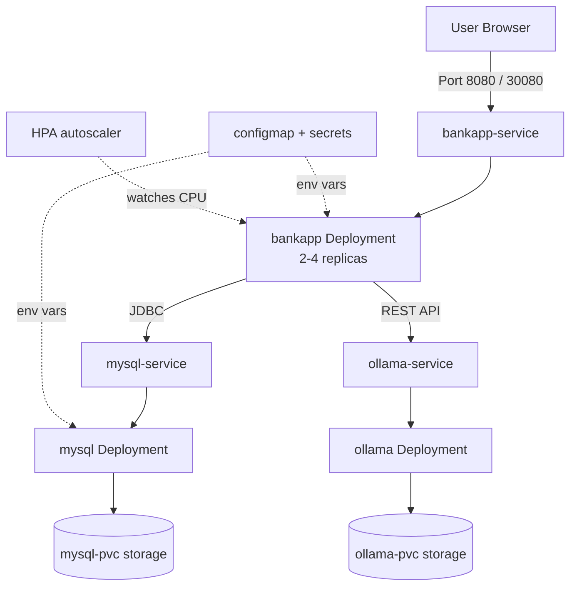

<div align="center">

# DevSecOps Banking Application

A containerized, AI-integrated banking platform built with Spring Boot 3 + Java 21, deployed on Kubernetes.
This README explains the **full architecture and folder structure** in simple terms — written so a beginner can understand exactly what every piece does.

</div>

---

## 1. What Is This Project?

This is a **bank application** with three moving parts working together:

1. **BankApp** — the main Spring Boot application users interact with (banking features + an AI assistant).
2. **MySQL** — the database that stores all banking data.
3. **Ollama (TinyLlama)** — a local AI engine that powers the AI assistant feature inside the app.

All three run as separate containers inside **Kubernetes**, talking to each other over the network — this is called a **microservices architecture**.

---

## 2. The Big Picture (How Everything Connects)



**In plain words:**
A user opens the app in a browser → the request hits `bankapp-service` → which forwards it to one of the `bankapp` Pods → the Pod talks to MySQL (for data) and Ollama (for AI replies) → all configuration (URLs, passwords) comes from `configmap` and `secrets` → an autoscaler (`HPA`) watches CPU usage and adds/removes app Pods automatically.

---

## 3. Why One Namespace?

Everything (MySQL, Ollama, BankApp) lives inside **one namespace**: `bankapp`.

A namespace is just a labeled "room" inside the cluster. Putting all three services in the same room means:
- They can find each other by simple names (`mysql-service`, `ollama-service`) — no extra configuration needed.
- It's easier to manage, view, and delete everything together (`kubectl get all -n bankapp`).

Separate namespaces are only needed when isolating different **environments** (dev/staging/prod) or different **teams** — not for parts of the same app.

---

## 4. Folder Structure Explained

```
AI-Bank-DeVops/
├── .github/workflows/     → CI/CD pipeline (GitHub Actions: build, scan, deploy)
├── .mvn/wrapper/          → Maven wrapper files (build tool)
├── k8s/                   → All Kubernetes manifests (the real deployment files)
├── screenshots/           → Images used in documentation
├── scripts/               → Helper shell scripts (e.g. Ollama setup on EC2)
├── setup-k8s/             → Local Kind cluster setup files + guide
├── src/                   → Java Spring Boot source code
├── Dockerfile             → Instructions to build the app's container image
├── docker-compose.yml     → Run everything locally with Docker (no Kubernetes)
├── app-tier.yml           → App-tier config for AWS EC2 deployment (non-K8s)
├── pom.xml                → Maven project + dependency definitions
└── README.md              → This file
```

---

## 5. Kubernetes Files — One by One

Every file in `k8s/` has exactly one job. Apply order matters because some resources depend on others already existing.

| # | File | What It Does | Depends On |
|---|------|---------------|------------|
| 1 | `namespace.yml` | Creates the `bankapp` room where everything else lives | Nothing |
| 2 | `configmap.yml` | Stores non-secret settings (DB host, port, Ollama URL) | Namespace |
| 3 | `secrets.yml` | Stores sensitive values (passwords) in base64 | Namespace |
| 4 | `pv.yml` | Reserves physical disk space on the node (`PersistentVolume`) | Nothing |
| 5 | `pvc.yml` | Claims that disk space for a specific app to use (`PersistentVolumeClaim`) | PV |
| 6 | `mysql-deployment.yml` | Runs the MySQL 8.0 container, mounts storage, reads secrets | ConfigMap, Secret, PVC |
| 7 | `ollama-deployment.yml` | Runs the Ollama AI engine, auto-pulls the `tinyllama` model on startup | PVC |
| 8 | `bankapp-deployment.yml` | Runs 2 replicas of the main app; waits for MySQL + Ollama before starting | ConfigMap, Secret, MySQL & Ollama running |
| 9 | `service.yml` | Creates 3 network "front doors": `mysql-service`, `ollama-service`, `bankapp-service` | Deployments |
| 10 | `hpa.yml` | Auto-scales `bankapp` between 2–4 Pods based on CPU usage | Deployment + metrics-server |
| 11 | `gateway.yml` | Optional advanced routing via Gateway API + Envoy (needs extra setup) | Service |
| 12 | `pod.yml` | A standalone test Pod (not part of normal deployment flow) | — |
| 13 | `dashboard-admin.yml` | Grants admin access to the Kubernetes Dashboard UI | Dashboard installed |

### Why `bankapp-deployment.yml` waits before starting

It uses **initContainers** — small helper containers that run *before* the main app starts:

```yaml
initContainers:
  - name: wait-for-mysql
    command: ["/bin/sh", "-c", "until nc -z mysql-service 3306; do sleep 2; done"]
  - name: wait-for-ollama
    command: ["/bin/sh", "-c", "until nc -z ollama-service 11434; do sleep 2; done"]
```

This means: *"Don't start the bank app until MySQL and Ollama are actually reachable."* This prevents crash loops caused by the app trying to connect to a database that isn't ready yet.

---

## 6. Networking — How Services Talk

| Service | Type | Port | Who Uses It |
|---------|------|------|--------------|
| `mysql-service` | ClusterIP (internal only) | 3306 | `bankapp` Pods only |
| `ollama-service` | ClusterIP (internal only) | 11434 | `bankapp` Pods only |
| `bankapp-service` | **NodePort** (external) | 8080 → 30080 | End users, browsers |

`bankapp-service` also uses:
```yaml
sessionAffinity: ClientIP
```
This means the **same user always lands on the same Pod** for their whole session (up to 1 hour of inactivity) — important for a banking app where session data shouldn't jump between replicas.

---

## 7. Local Development with Kind

For running this entire stack on your own laptop (no AWS needed), the project uses **Kind** (Kubernetes-in-Docker).

**`setup-k8s/kind-config.yml`** creates a 3-node local cluster:

```yaml
kind: Cluster
apiVersion: kind.x-k8s.io/v1alpha4
name: tws-cluster

nodes:
- role: control-plane
  image: kindest/node:v1.35.0
  extraPortMappings:
    - containerPort: 30080
      hostPort: 8080
      protocol: TCP
- role: worker
  image: kindest/node:v1.35.0
- role: worker
  image: kindest/node:v1.35.0
```

- **1 control-plane + 2 workers** → mimics a real multi-node cluster.
- **`extraPortMappings`** → maps the app's internal NodePort (`30080`) to your laptop's `localhost:8080`. This is why, once deployed, you open the app at `http://localhost:8080` instead of needing `kubectl port-forward`.

---

## 8. Complete Setup — Step by Step

```bash
# ── 1. Build the app image ──────────────────────────────
docker build -t trainwithshubham/bankapp:k8s .

# ── 2. Create the local Kind cluster ────────────────────
kind create cluster --config setup-k8s/kind-config.yml

# ── 3. Load the image into the cluster ──────────────────
# (Kind can't see your local Docker images automatically)
kind load docker-image trainwithshubham/bankapp:k8s --name tws-cluster

# ── 4. Install metrics-server (required for autoscaling) ─
kubectl apply -f https://github.com/kubernetes-sigs/metrics-server/releases/latest/download/components.yaml
kubectl patch deployment metrics-server -n kube-system \
  --type='json' \
  -p='[{"op":"add","path":"/spec/template/spec/containers/0/args/-","value":"--kubelet-insecure-tls"}]'

# ── 5. Apply all manifests in dependency order ──────────
kubectl apply -f k8s/namespace.yml
kubectl apply -f k8s/configmap.yml
kubectl apply -f k8s/secrets.yml
kubectl apply -f k8s/pv.yml
kubectl apply -f k8s/pvc.yml
kubectl apply -f k8s/mysql-deployment.yml
kubectl apply -f k8s/ollama-deployment.yml
kubectl apply -f k8s/bankapp-deployment.yml
kubectl apply -f k8s/service.yml
kubectl apply -f k8s/hpa.yml

# ── 6. Verify everything is running ─────────────────────
kubectl get all -n bankapp
```

Once every Pod shows `Running` / `1/1 Ready`, open:

```
http://localhost:8080
```

No `kubectl port-forward` is needed — the Kind cluster already mapped the port for you.

---

## 9. Useful Commands Cheat Sheet

| Goal | Command |
|------|---------|
| See all resources | `kubectl get all -n bankapp` |
| See Pod details / errors | `kubectl describe pod <pod-name> -n bankapp` |
| See container logs | `kubectl logs <pod-name> -n bankapp` |
| Check autoscaler status | `kubectl get hpa -n bankapp -w` |
| Check live CPU/memory | `kubectl top pods -n bankapp` |
| Delete everything | `kubectl delete namespace bankapp` |
| Manual traffic forward (only if NodePort isn't mapped) | `kubectl port-forward svc/bankapp-service 8080:8080 -n bankapp` |

---

## 10. Testing Autoscaling (HPA)

Generate fake load to watch replicas scale up automatically:

```bash
kubectl run load-test --image=busybox:1.36 -n bankapp -- \
  sh -c "while true; do wget -q -O- http://bankapp-service:8080/actuator/health >/dev/null 2>&1; done"

kubectl get hpa -n bankapp -w
```

Replicas will grow from **2 → 4** within 1–2 minutes as CPU usage crosses 70%. Clean up afterwards:

```bash
kubectl delete pod load-test -n bankapp
```

Scale-down happens automatically after 5 minutes of low CPU.

---

## 11. Production Deployment (AWS)

Beyond local Kind testing, this project also supports a full **AWS DevSecOps pipeline**:

- **ECR** — private container registry for the app image
- **EC2 (App Tier)** — runs the app + MySQL via Docker Compose
- **EC2 (AI Tier)** — dedicated instance running Ollama
- **GitHub Actions** — 9-stage security pipeline (secret scan → lint → SAST → SCA → build → container scan → push → deploy → DAST)
- **AWS Secrets Manager + IAM OIDC** — secure, keyless authentication from CI/CD to AWS

See `.github/workflows/` for the pipeline definition and `app-tier.yml` for the EC2 deployment config.

---

## 12. Quick Glossary (For Beginners)

| Term | Simple Meaning |
|------|-----------------|
| **Pod** | The smallest unit in Kubernetes — usually one running container |
| **Deployment** | Manages a group of identical Pods, handles restarts and updates |
| **Service** | A stable network address that routes traffic to healthy Pods |
| **ConfigMap** | Stores plain-text settings (not secret) |
| **Secret** | Stores sensitive values, base64-encoded |
| **PV / PVC** | Disk storage reserved for a Pod so data survives restarts |
| **Namespace** | A logical grouping/isolation boundary inside a cluster |
| **HPA** | Automatically adds/removes Pods based on load |
| **NodePort** | Exposes a Service on a fixed port, reachable from outside the cluster |
| **initContainer** | A setup container that must finish before the main container starts |

---

<div align="center">

Built with Java 21 · Spring Boot 3.4.1 · MySQL 8.0 · Ollama (TinyLlama) · Kubernetes · Docker

</div>
